# Task App V2

Una aplicación de lista de tareas construida con Spring Boot 4 y la base de datos
H2.

## Empieza aquí

### Empieza aquí

¿Listo para poner a trabajar tus conocimientos de Java?

En este build de Devtiro te guiaré paso a paso para que desarrolles una
aplicación web de gestión de tareas con Java y Spring Boot.

Pero no será un simple ejercicio de copiar y pegar. Por el camino veremos la
teoría de Spring Boot que _necesitas_ conocer.

Me llamo Aaron Bourne. Empecé a programar en 2008. Desde entonces he convertido
una fascinación de friki en una carrera satisfactoria, desarrollando software y
dirigiendo equipos.

Ahora enseño las mismas habilidades de desarrollo de software que uso
profesionalmente a través de Devtiro, mi empresa de formación. Puedes encontrar
a [Devtiro en YouTube](https://www.youtube.com/@devtiro).

Ya que nos conocemos, respondamos algunas preguntas.

Empecemos por: «¿Qué es un build de Devtiro?».

#### ¿Qué es un build de Devtiro?

Bueno, ¡vamos a construir una app juntos! Yo te guiaré en cada paso.

Para lograrlo he creado lo siguiente:

- Este documento.
- Un vídeo guiado del build que puedes ver en YouTube.
- El código fuente de referencia que puedes descargar en GitHub.
- Una interfaz de usuario (UI) que puedes ejecutar en tu máquina.

Y lo mejor: te lo doy **gratis**.

Mi objetivo es darte todo lo que necesitas para construir tu primera aplicación
web con Java y Spring Boot.

¿Cómo consigues los recursos del build? Encontrarás los enlaces al principio de
esta página.

Más adelante te mostraré cómo conseguir la UI, en el momento del build en que
tenga más sentido.

Ahora intentaré adivinar tu siguiente pregunta: «¿Debería construir esta app?».

#### ¿Debería construir esta app?

##### Lo que necesitas saber

Si tienes una base sólida de Java y eres nuevo en Spring Boot, este build es
para ti.

Si eres nuevo en Java, o en el desarrollo de software en general, **este build
será demasiado avanzado**.

Lo ideal es que hayas usado Java profesionalmente. Quizá escribas tests en Java,
o quizá uses Java para construir algo que no sean aplicaciones web con Spring
Boot.

Si todavía no cumples estos requisitos, no pasa nada. La buena noticia es que
puedes aprender todo esto online y gratis. Siempre puedes volver a este build
cuando estés preparado.

##### Estilo de código

Creo que el código limpio es una _gran_ idea. Pero, más que eso, creo que es una
parte necesaria del desarrollo de software profesional.

No todo el mundo comparte mi opinión, y no pasa nada. No estoy aquí para
convencerte de lo contrario.

Dicho esto, el código que escribimos en este build sigue mi interpretación del
código limpio.

Usaremos los patrones y convenciones que yo, y muchos otros, usamos para
escribir código de producción cada día.

No es el código más conciso, ni el más _ingenioso_. Porque así no se gana en el
desarrollo de software profesional. Ganas cuando escribes código _mantenible_.

Si estás en contra de escribir código limpio, o buscas algo deliberadamente
oscuro, no lo encontrarás aquí. Que tengas suerte en tu búsqueda, ¡sin rencor!

Si te entusiasma la idea de desarrollar una app como lo hacemos
profesionalmente, te animo a seguir leyendo.

##### El enfoque de Devtiro

El objetivo de un build de Devtiro no es enseñarte todo lo que hay que saber.

El objetivo es enseñarte el 20% más importante.

¿Has oído hablar del principio de Pareto? No te aburriré con todos los detalles.
En pocas palabras, significa que «un pequeño número de entradas suele producir
la mayor parte de la salida».

Dicho de otro modo, he intentado identificar las cosas _más importantes_ que
debes saber para construir una app de tareas con Java y Spring Boot.
Naturalmente, he dejado muchas fuera. Pero creo que lo que queda debería darte
lo necesario para hacer el trabajo, y hacerlo bien.

Dicho esto, **tendrás** preguntas por el camino. Es normal y forma parte del
proceso de aprendizaje.

Cada vez que buscas una respuesta a tu pregunta, estás aprendiendo. Eso es
exactamente lo que quieres. ¡Eso es progreso!

Veamos dónde puedes buscar esas respuestas.

#### Ayuda y soporte

En cuanto al soporte, no me es posible ayudar a todo el mundo individualmente.
Por eso, **no puedo responder a tus solicitudes de soporte directas**.

Cuando te quedes atascado, trátalo como parte del proceso de aprendizaje: buscar
la respuesta es lo que hace que la habilidad se quede.

#### Herramientas de desarrollo

Este build requiere las siguientes herramientas:

- El Kit de Desarrollo de Java (JDK)
- El IDE IntelliJ IDEA
- Docker

Todas estas herramientas están disponibles gratis online. No tienes que comprar
nada para este build.

#### Versiones de software

Este build está pensado para la versión `25` de Java y la versión `4.0.X` de
Spring Boot.

Si decides usar otra versión de Java o de Spring Boot, los pasos de este build
**pueden no funcionar**.

Usa siempre que puedas las versiones especificadas en el build.

#### Errata

Dedico mucho tiempo y esfuerzo a crear builds de Devtiro para ti. Sin embargo,
como en toda obra creativa, es posible que haya alguna errata.

Si crees que has encontrado una inexactitud técnica u otra errata, puedes
comunicarla escribiendo a contact@devtiro.com.

## Visión general del build

### El brief del proyecto

¿Qué tiene que hacer nuestra app? Veamos los requisitos de este build.

#### La vista desde 10.000 pies

Vamos a construir una app en la que el usuario pueda anotar las tareas que
planea completar en el futuro.

A las apps así a veces se las llama «lista de tareas» (todo list) o
«recordatorios».

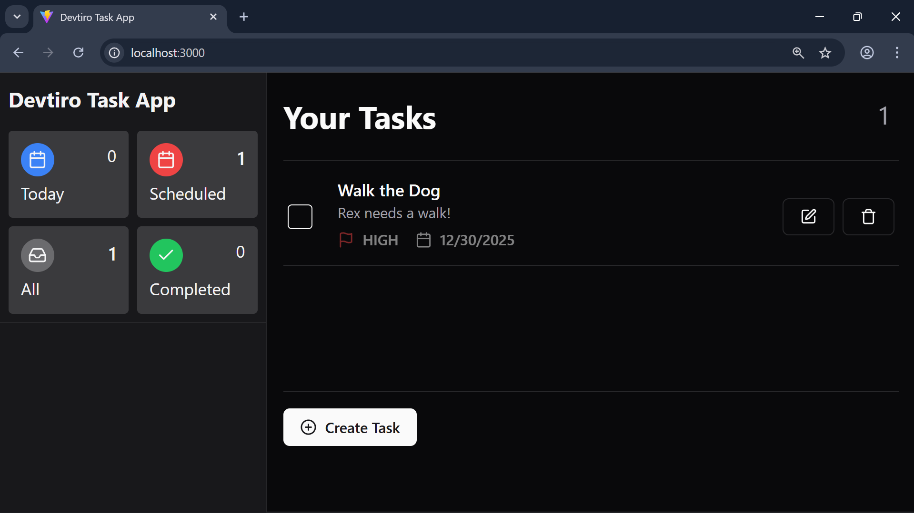

El principio es sencillo: el usuario crea una «tarea», que podría ser, por
ejemplo, «Sacar al perro».

Puede añadir más detalles en forma de _descripción_, como «Llevar a Rex al
parque».

Puede añadir una _fecha de vencimiento_ para la que pretende completar la tarea.

Puede indicar la _prioridad_ de la tarea: ¿alta, media o baja?

Pero el objetivo de toda tarea es siempre el mismo: recordarla y completarla.

A estas alturas probablemente ya captes la idea de lo que vamos a construir.
¿Basta para empezar a programar? No del todo. Veamos cómo recoger los requisitos
de esta app.

#### ¿Qué es una historia de usuario?

Tenemos que concretar más lo que vamos a construir, así que recogemos los
requisitos de este build con una técnica llamada «historias de usuario» (user
stories).

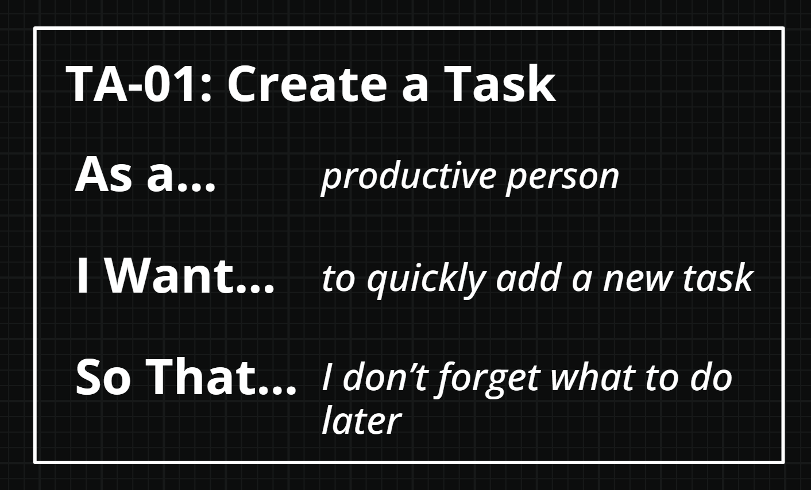

Es una técnica sencilla pero potente que verás a menudo en los equipos de
desarrollo Agile.

Existen variantes, pero este es el enfoque de Devtiro.

##### Título

Cada historia de usuario tiene un título que resume su propósito. Un ejemplo
podría ser «Crear una tarea».

Para identificar cada historia de usuario uso un prefijo codificado, así que el
título completo es «TA-01 - Crear una tarea».

Esta historia de usuario trata de crear una tarea.

##### Como, quiero, para

Cada historia de usuario sigue una estructura concreta de tres frases.

La primera frase empieza por «Como», por ejemplo «Como persona productiva».
Esto nos dice _quién_ es el sujeto de la historia. En este caso, una «persona
productiva».

La segunda empieza por «quiero», por ejemplo «quiero poder añadir una tarea
nueva rápidamente». Esta línea nos dice _qué_ debe entregar la historia.

La última empieza por «para», por ejemplo «para no olvidar lo que tengo que
hacer después». Esto nos dice _por qué_ implementamos la historia.

Un requisito tradicional como «el sistema debe registrar las tareas del
usuario» nos dice _qué_, pero nuestra historia de usuario nos dice _quién_,
_qué_ y _por qué_.

Ese contexto extra es valioso, y por eso usamos historias de usuario.

##### Criterios de aceptación

Por último, toda historia de usuario de Devtiro tiene un conjunto de criterios
de aceptación.

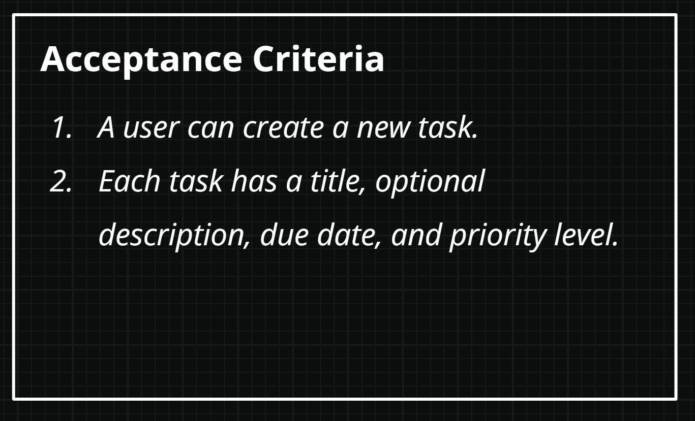

La estructura de tres frases por sí sola sigue siendo algo vaga; ahí entran en
juego los criterios de aceptación.

Los criterios de aceptación son frases que se evalúan como verdaderas o falsas.

El objetivo es que todos los criterios de aceptación de la historia sean
verdaderos. Ahí es cuando puedes decir que has completado la historia.

Por ejemplo, «un usuario puede crear una tarea nueva» empieza siendo falso al
inicio del proyecto. Sin embargo, una vez que hemos escrito el código que
permite al usuario crear una tarea, ese criterio pasa a ser verdadero.

Veamos las historias de usuario de este build:

#### Historias de usuario de la app de tareas

En total, este build tiene cuatro historias de usuario:

##### TA-01 - Crear una tarea

**Como** persona productiva.

**Quiero** añadir una tarea nueva rápidamente.

**Para** no olvidar lo que tengo que hacer después.

**Criterios de aceptación**

1. Un usuario puede crear una tarea nueva.

2. Cada tarea tiene un título, una descripción opcional, una fecha de
   vencimiento y un nivel de prioridad.

##### TA-02 - Actualizar una tarea

**Como** persona productiva.

**Quiero** actualizar tareas existentes.

**Para** poder corregir errores y mantener mis tareas al día.

**Criterios de aceptación**

1. Los usuarios pueden editar el título, la descripción, la fecha de
   vencimiento, el nivel de prioridad y el estado de una tarea.

##### TA-03 - Eliminar una tarea

**Como** persona productiva.

**Quiero** eliminar una tarea existente.

**Para** poder quitar las tareas que ya no necesito.

**Criterios de aceptación**

1. Los usuarios pueden eliminar tareas.

##### TA-04 - Completar una tarea

**Como** usuario productivo.

**Quiero** marcar una tarea como completada.

**Para** saber qué tareas requieren mi atención.

**Criterios de aceptación**

1. Los usuarios pueden marcar tareas abiertas como completadas.
2. Los usuarios pueden volver a marcar tareas completadas como abiertas.

Ahora que entendemos qué debe hacer la app, veamos cómo lo hace. Echemos un
vistazo a la app terminada.

#### Resumen

- Exploramos el concepto de historia de usuario.
- Definimos los requisitos del build como historias de usuario.

### Visión general de la app

Ya hemos explorado los requisitos. Ahora veámoslos en acción.

Echemos un vistazo a la app terminada.

#### Crear una tarea

Crear una tarea nueva es una función esencial de una app de tareas.

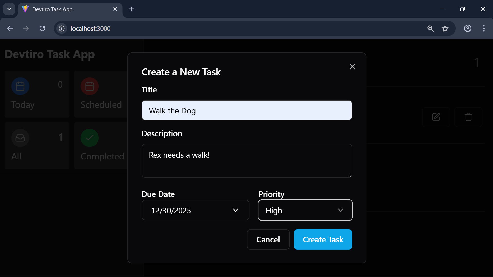

Para crear una tarea nueva:

1. Haz clic en el botón «Create Task» de la esquina inferior izquierda de la
   página. Se abrirá un diálogo con un formulario para crear una tarea.
2. Escribe un título, una descripción opcional, una fecha de vencimiento
   opcional y selecciona una prioridad. Haz clic en «Create Task» para crear la
   tarea.
3. Verás la tarea nueva en la lista de tareas.

#### Actualizar una tarea

Actualizar una tarea es la segunda función de nuestra app. Así se hace:

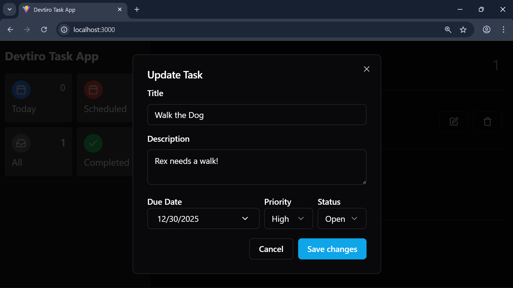

1. Haz clic en el botón de editar de la tarea que quieras modificar. Se abrirá
   un diálogo para editar la tarea existente.
2. Verás todos los datos actuales de la tarea. Edita cada campo. Haz clic en
   «Save Changes».
3. Verás la tarea actualizada en la lista de tareas.

#### Completar una tarea

Este es el objetivo final de toda tarea. Veamos cómo completar una tarea:

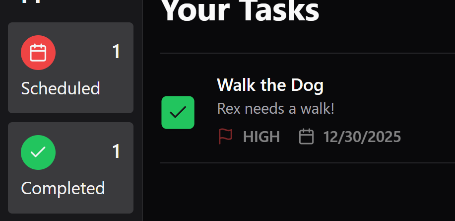

1. Marca la casilla que hay junto a la tarea que quieras completar.
2. La casilla queda marcada. Vuelve a hacer clic para reabrir la tarea.

> [!NOTE]
> También puedes cambiar el estado de la tarea desde el diálogo de edición.

#### Eliminar una tarea

Tarde o temprano tendrás que eliminar una tarea. Veamos cómo se hace:

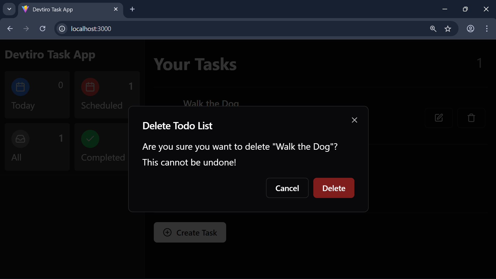

1. Haz clic en el botón de eliminar que hay junto a la tarea que quieras
   borrar. Se abrirá el diálogo de eliminación de la tarea.
2. Haz clic en «Delete» para eliminar la tarea.

Ahora que entendemos cómo funciona la app, veamos cómo la vamos a construir.

#### Resumen

- Exploramos cada función que vamos a implementar.

### Visión general del dominio

Hemos visto el brief del proyecto y hemos visto la app.

¿Cuál es el primer paso para pasar de uno a otra?

Echemos un vistazo al dominio de la app.

#### ¿Qué es un dominio?

Cuando aprendiste Java, seguro que aprendiste programación orientada a objetos
(POO).

Cuando desarrollamos software en un lenguaje orientado a objetos como Java,
escribimos código para modelar cosas del mundo real, o «objetos».

Qué objetos usamos, cómo los estructuramos y cómo interactúan entre sí conforman
nuestra app.

A esos objetos los llamamos el «dominio» de la app. Y al proceso de determinar
los objetos del dominio lo llamamos «modelado del dominio».

Existen distintas técnicas de modelado del dominio, como el _análisis
sustantivo-verbo_ o _Event Storming_. Sea cual sea la técnica que uses, considero
que el modelado del dominio es más un arte que una ciencia.

Para que todo resulte accesible en este build, te daré el modelo de dominio al
que llegué.

¡Exploremos el dominio de la app!

#### Explora el dominio de la app

No necesitas ninguna técnica sofisticada para saber que una app de tareas
necesita un objeto que modele una _tarea_.

Lo que no es tan obvio es qué estado y qué comportamiento debe tener ese objeto
tarea para que nuestra app funcione.

Por ahora nos centraremos en el estado, es decir, en los campos que necesita
esta clase. A partir de ahí aprenderemos a estructurar nuestros datos.

Modelar el comportamiento, o los métodos de la clase, es menos importante en
esta fase.

Empecemos con una clase `Task` para modelar las tareas de nuestra app.

Ahora preguntémonos: «¿qué define una tarea?».

##### Título y descripción

Sabemos que cada tarea tiene un _título_ y una _descripción_ opcional.

Son datos de texto, así que usaremos el tipo `String` para los campos `title` y
`description` de la clase `Task`.

##### Fecha de vencimiento

El brief del proyecto también menciona la _fecha de vencimiento_ de una tarea, es
decir, cuándo debería completarla el usuario.

En nuestra app dejaremos que el usuario elija una fecha, pero no una hora. Eso
significa que podemos usar el tipo `LocalDate` de Java para el campo `dueDate`.

##### Estado de la tarea

¿Cuál es el objetivo de toda tarea? ¡Pasar de _abierta_ a _completada_! Eso nos
dice que un objeto tarea puede estar en al menos uno de dos estados.

Podríamos usar un boolean, donde `false` significa que la tarea está abierta y
`true` que está completada.

Pero ¿y si más adelante queremos añadir más estados? ¿Quizá un estado
_archivada_ o _cancelada_? ¡Con un boolean no será fácil!

Por eso usaremos una enumeración, o «enum», llamada `TaskStatus`. Tiene un valor
`OPEN` para una tarea que el usuario todavía no ha hecho y un valor `COMPLETE`
para una tarea que ya ha completado.

Usaremos el tipo `TaskStatus` para el campo `status` de nuestra clase `Task`.

##### Prioridad de la tarea

Algunas tareas son más importantes que otras, así que necesitan un nivel de
prioridad.

Usaremos las prioridades «alta», «media» y «baja». Como las opciones son
limitadas y las conocemos de antemano, es otro caso ideal para un enum.

Usaremos un enum `TaskPriority`, que puede tener los valores `HIGH`, `MEDIUM` y
`LOW`.

Usaremos el tipo `TaskPriority` para el campo `priority` de nuestra clase `Task`.

##### ID

Ya hemos recogido todos los campos que necesitamos según el brief, así que ¿qué
nos falta?

Déjame preguntarte: «¿cómo puede nuestra app distinguir un objeto tarea de
otro?». Puede que tengan títulos distintos, pero necesitamos algo más fiable.
¡Necesitamos un identificador único!

Podríamos usar un ID numérico, que sería único en nuestra base de datos. Sin
embargo, los identificadores únicos universales (UUID) tienen la ventaja añadida
de ser únicos en cualquier sitio. Eso nos da opciones extra para futuras
funciones.

Usaremos el tipo `UUID` para el campo `id` de nuestra app de tareas.

##### Creado y actualizado

Puede ser útil saber la fecha y la hora en que se creó un objeto y en que se
actualizó por última vez.

Me gusta llamarlos campos de _auditoría_. Nos dan información útil para
comprobar que todo funciona como debería.

Usaremos el tipo `Instant` de Java para los campos `created` y `updated` de la
clase `Task`, lo que nos permite recoger fecha, hora e información de zona
horaria.

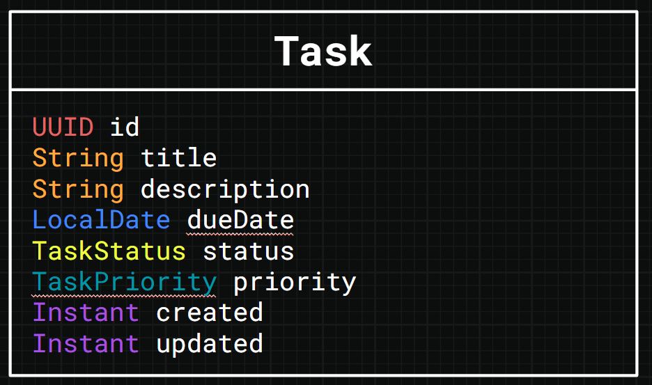

Con esto hemos modelado todo el dominio de la app, pero antes de ponernos a
programar, definamos la arquitectura.

#### Resumen

- Exploramos el concepto de dominio de una app.
- Diseñamos el dominio de la app de tareas.

### Visión general de la arquitectura

¿Cómo está construida la app? ¿Cuáles son sus componentes? ¿Cómo encajan entre
sí?

Buenas preguntas. Vamos a responderlas.

#### Arquitectura de alto nivel

Este es un build pensado para principiantes, y su arquitectura está a la altura:
sencilla.

La app tiene dos componentes principales:

1. La aplicación Spring Boot
2. La interfaz de usuario, o «UI»

El usuario interactúa con la UI desde el navegador. La UI interactúa con la
aplicación Spring Boot haciendo llamadas a su REST API.

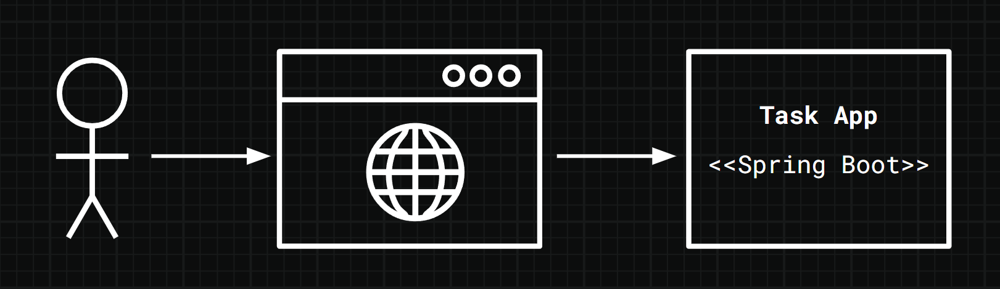

Veamos cada componente con algo más de detalle.

#### La aplicación Spring Boot

El foco de este build es la aplicación Spring Boot.

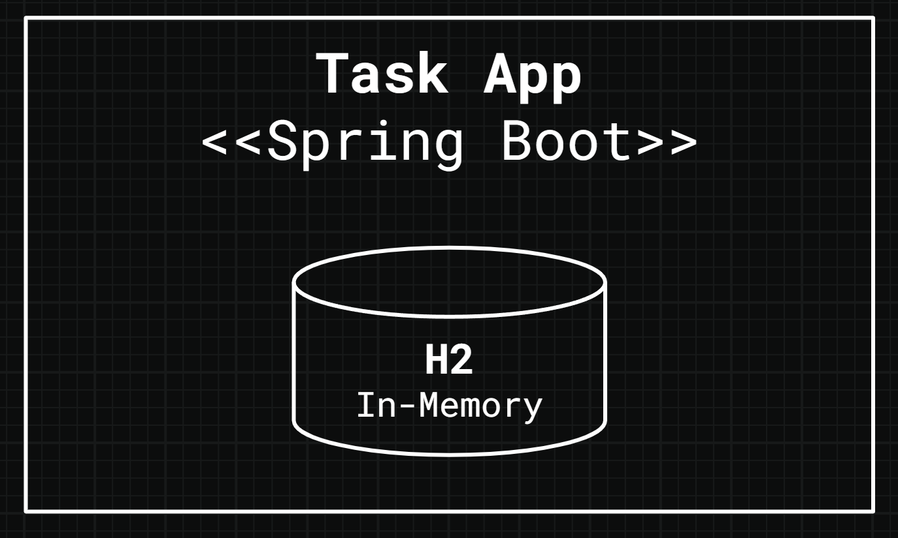

Para simplificar, guardaremos los datos en una base de datos H2 en memoria. Se
ejecuta automáticamente al arrancar la app, lo que reduce la infraestructura que
tenemos que montar.

Sin embargo, como la base de datos H2 está en memoria, perdemos los datos al
reiniciar la aplicación Spring Boot. Es un compromiso que merece la pena para
simplificar un poco las cosas por ahora.

En cuanto a ejecutar la aplicación Spring Boot, lo haremos directamente desde
IntelliJ.

Esto expone la REST API a la interfaz de usuario.

#### La interfaz de usuario

He construido la UI por ti y la he empaquetado como imagen de Docker para que sea
fácil de ejecutar.

> [!NOTE]
> Más adelante en el build veremos cómo ejecutar la UI.

Cuando esté funcionando, interactuarás con la UI desde el navegador. Al pulsar
botones y rellenar formularios se envían peticiones a la REST API de la
aplicación Spring Boot.

Eso hace que la app ejecute acciones según la lógica de negocio que hemos
programado y devuelva una respuesta adecuada a la UI.

Así es como la UI y la aplicación Spring Boot trabajan juntas.

En la siguiente lección veremos la teoría de REST API y el diseño de la REST API
de nuestra app.

#### Resumen

- Exploramos la arquitectura de la app de tareas, incluidos el componente de la
  aplicación Spring Boot y el componente de la UI.

### Visión general de la REST API

Nuestra app de tareas en Spring Boot expone una REST API, pero ¿qué _es_ una
REST API?

#### ¿Qué es REST?

Una API (Application Programming Interface, interfaz de programación de
aplicaciones) es un conjunto de reglas y protocolos que permite que distintos
componentes de software se comuniquen entre sí.

Existen distintos tipos de API. Nuestra aplicación Spring Boot expone una REST
API.

REST (Representational State Transfer, transferencia de estado representacional)
es un conjunto de convenciones construidas sobre HTTP. Seguimos esas
convenciones para crear REST APIs.

Como usamos HTTP, trabajamos con el patrón de petición y respuesta. Un cliente
envía una petición y espera que el servidor le dé una respuesta a tiempo.

Decimos que la UI es un «cliente» de la REST API que expone nuestra aplicación
Spring Boot, y que la aplicación Spring Boot es el «servidor».

También significa que podemos usar cosas como los verbos HTTP, las cabeceras y
los códigos de respuesta.

Veamos cómo encajan estas piezas en una REST API.

#### Recursos web

Al diseñar REST APIs, todo empieza por los _recursos web_.

Los recursos web se corresponden con los objetos del dominio de tu app.

En nuestro caso solo tenemos un objeto de dominio, la _tarea_, así que solo hay
un recurso web que considerar: la tarea.

¿Cómo representamos un recurso web en una REST API?

##### Formato de los recursos web

En REST, los recursos web se representan normalmente en JSON, XML o ambos.
Usaremos JSON, lo que significa que representaremos las tareas en formato JSON
en las peticiones y respuestas que intercambiamos con nuestra aplicación Spring
Boot.

##### Recursos web y URLs

En las REST APIs representamos cada recurso web con una URL.

Al construir una URL usamos los sustantivos en plural. Por ejemplo, podemos
representar el recurso web de tareas con esta URL:

```text
/tasks
```

Pero hay más en esta convención. Esta URL representa en realidad **todas** las
tareas de la app, la «colección» de tareas, no una tarea _concreta_.

Para representar una tarea concreta tenemos que indicar su ID en la URL. Si damos
por hecho que usamos UUID como ID de tarea, la URL de una tarea concreta podría
ser:

```text
/tasks/60f30f9f-2231-43b6-94d4-c8f4d44f4d83
```

Los recursos web son _cosas_, así que construimos las URLs con sustantivos y
evitamos los verbos. En su lugar, nos apoyamos en otra característica de HTTP
para comunicar comportamiento: los verbos HTTP.

#### Verbos HTTP

Los clientes de una REST API indican un verbo HTTP al hacer una petición.

Los verbos HTTP incluyen `GET`, `POST`, `PUT`, `PATCH` y `DELETE`. Permiten al
cliente crear, leer, actualizar y eliminar el recurso web. A esto se le suele
llamar comportamiento «CRUD».

##### HTTP GET

Usamos HTTP GET para leer recursos web. Por ejemplo, para obtener un único
recurso de tarea:

```text
GET /tasks/60f30f9f-2231-43b6-94d4-c8f4d44f4d83
```

Devuelve la tarea con ID `60f30f9f-2231-43b6-94d4-c8f4d44f4d83` como objeto
JSON en el cuerpo de la respuesta.

¿Y si queremos obtener todas las tareas de la app? La llamada sería:

```text
GET /tasks
```

No hace falta enviar nada en el cuerpo de una petición `GET`.

El verbo `GET` de HTTP se corresponde con «read» (leer), la «R» de CRUD.

##### HTTP POST

Un cliente usa el verbo `POST` de HTTP para crear un recurso web.

Para ello, el cliente envía en el cuerpo de la petición una representación del
recurso web que quiere crear.

Una convención importante de `POST` es que nunca debemos permitir que el cliente
especifique el ID del recurso web. Es responsabilidad del servidor.

Por ejemplo, para crear una tarea la URL sería `POST /tasks`, con una
representación JSON de la tarea a crear en el cuerpo de la petición.

El verbo `POST` de HTTP se corresponde con «create» (crear), la «C» de CRUD.

##### HTTP PUT

Un cliente usaría el verbo `PUT` de HTTP para crear o actualizar un recurso web.

Quizá te preguntes en qué se diferencia `PUT` de `POST`. A diferencia de `POST`,
con `PUT` siempre indicas el ID del recurso web en la URL, junto con la
representación completa de la tarea a crear en el cuerpo de la petición.

Según cómo implementes este endpoint, puedes usarlo para crear tareas o para
actualizarlas.

Un requisito clave de `PUT` es que debes enviar la representación completa del
recurso web en el cuerpo de la petición, salvo los campos que gestiona el
servidor, como `created`.

Si ya existe una tarea con el ID indicado, la app sustituye su información por
la que envíe quien hace la llamada en el cuerpo de la petición.

El verbo `PUT` de HTTP se corresponde con «create» (crear), la «C» de CRUD, y
también con «update» (actualizar), la «U» de CRUD.

También puedes actualizar recursos web con el verbo `PATCH`, pero como no lo
usaremos en este build, no entraremos en detalles sobre `PATCH` aquí.

##### HTTP DELETE

Luego está HTTP `DELETE`. Indicamos el ID del recurso web en la URL y usamos esta
llamada para eliminarlo. No enviamos nada en el cuerpo de la petición.

Según la implementación, DELETE puede eliminar la tarea de la base de datos, lo
que se llama «hard delete» (borrado físico), o añadir a la tarea una marca que
indique que está eliminada, lo que se llama «soft delete» (borrado lógico). Los
soft deletes son útiles por motivos de auditoría, pero implican conservar los
datos para siempre. Cuál uses depende de tus requisitos. En este build usamos
hard delete.

#### Códigos de estado

Una nota sobre los códigos de estado. Son códigos numéricos predefinidos que el
servidor indica en cada respuesta para comunicar el estado de la operación.

Como veremos más adelante, el código concreto que usamos varía según la
operación, pero hay un patrón general.

Los códigos de la serie 200 indican que la operación se completó con éxito.

Los de la serie 300 significan que el servidor intenta redirigir al cliente a
otra URL.

Los de la serie 400 significan que ha habido un error y que es responsabilidad
del cliente resolverlo antes de volver a intentarlo.

Los de la serie 500 también significan que ha habido un error, pero esta vez es
responsabilidad del servidor resolverlo.

Tienes cierto margen al diseñar tu REST API, pero por coherencia te recomiendo
seguir estas pautas.

#### Versionado

Es buena práctica versionar tus REST APIs. Aquí tienes un ejemplo de URL
versionada:

```text
GET /api/v1/tasks
```

¿Ves el prefijo `/api/v1`? En sentido estricto, solo necesitamos la parte `v1`
para versionar una REST API, pero a menudo también verás el prefijo `/api`.

La idea básica es esta: si introduces cambios incompatibles en tu REST API, en
lugar de desplegarla y romper el código de tus clientes, puedes desplegar una
versión nueva y ejecutarla junto a la actual:

```text
GET /api/v2/tasks
```

En la REST API de la app de tareas usamos versionado. Vamos a verla.

#### La REST API de la app de tareas

Ahora que entendemos REST, echemos un vistazo a la REST API de la app de
tareas.

Tiene cuatro endpoints:

1.  Crear una tarea.
2.  Listar tareas.
3.  Actualizar una tarea.
4.  Eliminar una tarea.

Antes de entrar en el detalle de cada endpoint, dediquemos un momento a pensar
cómo vamos a representar los errores.

##### Errores de la REST API

Las cosas fallan todo el tiempo, y nuestra app no es una excepción, así que
merece la pena gestionar los errores de forma coherente.

Para todos los errores, la REST API devuelve un formato estándar:

```json
{
  "error": "An error message"
}
```

Si el cliente ha hecho una llamada incorrecta, la respuesta tiene el estado
`HTTP 400 BAD REQUEST`. Si el error es del lado del servidor, la respuesta tiene
el estado `HTTP 500 INTERNAL SERVER ERROR`.

Esto vale para todos los endpoints de la app, así que veamos el primero.

##### Crear una tarea

Una llamada a este endpoint crea una tarea nueva.

El verbo HTTP `POST` es el más adecuado:

```text
POST /api/v1/tasks
```

Al llamar a este endpoint debemos enviar en el cuerpo de la petición una
representación de la tarea a crear:

```json
{
  "title": "Walk the Dog",
  "description": "Rex needs a walk!",
  "dueDate": "2025-12-31",
  "priority": "MEDIUM"
}
```

Si va bien, recibimos una respuesta con el estado `HTTP 201 CREATED` y una
representación de la tarea creada en el cuerpo de la respuesta:

```json
{
  "id": "33b24989-746a-4b98-aa21-6e5952a4d66b",
  "title": "Walk the Dog",
  "description": "Rex needs a walk!",
  "dueDate": "2025-12-31",
  "priority": "MEDIUM",
  "status": "OPEN"
}
```

> [!NOTE]
> Fíjate en que el cuerpo de la respuesta tiene un campo `id` y un campo
> `status`. La app los establece al crear la tarea; la UI no los envía.

##### Listar tareas

Listar todas las tareas de la app es una operación de lectura, así que usamos
HTTP `GET`:

```text
GET /api/v1/tasks
```

No enviamos nada en el cuerpo de esta petición.

Si va bien, la app devuelve una lista de tareas en el cuerpo de la respuesta,
junto con el estado `HTTP 200 OK`:

```json
[
  {
    "id": "3fa85f64-5717-4562-b3fc-2c963f66afa6",
    "title": "Task A",
    "description": "Task A description.",
    "dueDate": "2025-11-01",
    "priority": "MEDIUM",
    "status": "OPEN"
  },
  {
    "id": "44ddc656-4bfb-4c83-b0fa-239e863ad438",
    "title": "TASK B",
    "description": "Task B description.",
    "dueDate": "2025-11-02",
    "priority": "LOW",
    "status": "COMPLETED"
  }
]
```

##### Actualizar una tarea

De los verbos HTTP que se usan para actualizar recursos web, nuestra API usa
`PUT`:

```text
PUT /api/v1/tasks/3fa85f64-5717-4562-b3fc-2c963f66afa6
```

Eso significa que indicamos el ID de la tarea en la URL y enviamos en el cuerpo
de la petición la representación completa de la tarea actualizada:

```json
{
  "title": "Walk the Fish",
  "description": "Frank needs his exercise!",
  "dueDate": "2026-01-10",
  "priority": "HIGH",
  "status": "COMPLETED"
}
```

Bueno, casi completa. Omitiremos el campo `id` en la petición de actualización
porque ya lo enviamos en la URL.

Fíjate también en que no enviamos los campos `created` ni `updated`, porque los
gestiona el servidor. ¡No podemos actualizarlos a mano!

El endpoint de actualización devuelve `HTTP 200 OK` si va bien.

##### Eliminar una tarea

Por último tenemos el endpoint de eliminar tarea, que usa el verbo HTTP
`DELETE`:

```text
DELETE /api/v1/tasks/3fa85f64-5717-4562-b3fc-2c963f66afa6
```

No enviamos nada en el cuerpo de la petición y la app no devuelve nada en el
cuerpo de la respuesta.

De hecho, tanto si la tarea indicada en la URL existía como si no, la app
siempre devuelve `HTTP 204 NO CONTENT`.

Puede parecer raro, pero piénsalo así: tanto si la tarea existía como si no,
¡después de la llamada está claro que ya no existe!

Aunque no lo creas, este es el enfoque recomendado para los endpoints de borrado
de una REST API.

Ahora que hemos diseñado la REST API de la app, ¡vamos con la teoría de Spring
Boot que necesitamos para empezar a programar!

#### Resumen

- Exploramos el concepto de REST API.
- Definimos la REST API de la app de tareas.

## Configuración del proyecto

### Crear un proyecto nuevo

¡Empecemos un proyecto nuevo!

#### Spring Initializr

La forma más eficaz que conozco de empezar un proyecto Spring Boot es usar Spring
Initializr.

Spring Initializr es un sitio web donde indicas la configuración que quieres
para tu nuevo proyecto Spring Boot y te genera un proyecto esqueleto sobre el
que construir.

Para acceder a Spring Initializr, entra en
[https://start.spring.io/](https://start.spring.io/).

##### Configuración de proyecto y lenguaje

El primer bloque de configuración que debemos indicar es el de proyecto y
lenguaje.

Aquí respondemos a la pregunta: «¿qué herramienta y qué lenguaje de programación
queremos usar?».

En este build escribimos código Java con Apache Maven como herramienta de build,
así que asegúrate de seleccionar «Maven» en el apartado «Project» y «Java» en el
apartado «Language».

##### Versión de Spring Boot

Ahora, la versión de Spring Boot.

Esto es importante, porque distintas versiones de Spring Boot pueden funcionar
de formas sutilmente distintas.

Este build usa la versión `4.0.x` de Spring Boot, así que asegúrate de elegir la
última versión de la serie `4.0.x`. Por ejemplo, `4.0.0`, `4.0.1`, `4.0.2`, etc.

> [!CAUTION]
> Si eliges otra versión de Spring Boot, los pasos de este build pueden no
> funcionar.
>
> Usa siempre que puedas las versiones especificadas en el build.

##### Identidad del proyecto

Ahora, los metadatos del proyecto. Incluyen la configuración sobre cómo
identificamos el proyecto, cómo lo configuramos, cómo lo ejecutamos y qué versión
de Java usa nuestra app.

Empecemos por la configuración que identifica nuestro proyecto:

- **Group:** `com.devtiro`
- **Artifact:** `task`
- **Name:** `Devtiro Task App`
- **Description:** `A task tracking application.`
- **Package name:** `com.devtiro.task`

##### Empaquetado

Ahora el empaquetado: tenemos que seleccionar «Jar» y **no** «War». Elegir Jar
nos da un proyecto con un contenedor de aplicaciones incluido. Eso significa que
podemos ejecutar la app sin configurar nada extra.

Elegir War implicaría desplegar la app compilada en un contenedor de aplicaciones
aparte para ejecutarla. Es un paso adicional que no aporta valor a nuestro build,
así que no lo vamos a hacer.

##### Properties frente a YAML

En este build seleccionaremos «Properties» para la configuración. Properties
tiene la ventaja de ser más fácil de manejar, pero es menos flexible que YAML.
Por eso es la mejor opción para este build.

##### Versión de Java

En el momento de escribir esto, la última versión de Java es la `25`, así que
entre las opciones de versión de Java seleccionaremos `25`.

> [!CAUTION]
> Si eliges otra versión de Java, los pasos de este build pueden no funcionar.
>
> Usa siempre que puedas las versiones especificadas en el build.

##### Dependencias

Una de las grandes ventajas de usar Spring Boot es el amplio ecosistema de
dependencias al que tienes acceso.

Cada dependencia resuelve un problema concreto. Estas son las que necesitamos
para este build:

- **Spring Web**: lo necesitamos para construir la REST API de la app.
- **Validation**: lo necesitamos para validar las peticiones que se hacen a la
  REST API de la app.
- **Spring Data JPA**: lo necesitamos para interactuar con una base de datos
  usando objetos Java, en lugar de escribir SQL.
- **H2 Database**: lo necesitamos para ejecutar la base de datos en memoria que
  usamos en este build.

> [!CAUTION]
> ¡Asegúrate de seleccionar «Spring Web» y no «Spring Reactive Web»!

¡Eso es todo! Ahora haz clic en «GENERATE» para descargar tu proyecto Spring Boot
esqueleto.

#### Abrir el proyecto

Con el proyecto descargado, tenemos que abrirlo en IntelliJ IDEA para empezar a
desarrollar.

El archivo descargado es un zip, así que tenemos que descomprimirlo en algún
sitio de nuestra máquina que nos resulte cómodo.

Hecho eso, abrimos IntelliJ IDEA y seguimos estos pasos:

1.  Selecciona «File» -> «Open» en la barra de herramientas superior.
2.  Selecciona la carpeta descomprimida del proyecto en el explorador de
    archivos.
3.  Haz clic en «OK».

Esto abre el proyecto en IntelliJ, ¡listo para empezar a desarrollar!

#### Resumen

- Usamos Spring Initializr para crear un proyecto nuevo.
- Abrimos el proyecto nuevo en IntelliJ IDEA.

### Ejecutar la UI

Ya hemos creado un proyecto Spring Boot nuevo; ahora ejecutemos la interfaz de
usuario.

#### Docker Compose

Para ejecutar la UI usaremos Docker Compose. Así podemos construir la imagen
Docker de la UI y ejecutarla con toda la configuración que necesita para
comunicarse con nuestra aplicación Spring Boot.

El código fuente de la UI está en el directorio `frontend` de este repositorio, y
Docker Compose lo convertirá en una imagen por ti. No necesitas saber React ni
instalar Node para ejecutarla.

Necesitas Docker instalado en tu máquina para ejecutar la UI. Una vez instalado,
puedes ejecutar la UI con un único archivo.

Si aún no has instalado Docker, encontrarás información de cómo hacerlo en la
[web de Docker](https://www.docker.com/).

Para empezar, creemos un archivo llamado `docker-compose.yml` en la raíz de
nuestro proyecto. Luego pondremos el siguiente contenido:

```yaml
# The name of the Docker Compose environment.
name: devtiro-build-task-app
services:
  # The UI service.
  ui:
    # Build the UI image from the source in the frontend directory.
    build: ./frontend
    ports:
      # Make the UI available on http://localhost:3000
      - '3000:3000'
    # Tell the UI how to find your Spring Boot app.
    environment:
      - BACKEND_HOST=host.docker.internal
      - BACKEND_PORT=8080
    # For Linux compatibility
    extra_hosts:
      - 'host.docker.internal:host-gateway'
```

La primera vez que lo ejecutes, Docker construirá la imagen de la UI, lo que tarda
un minuto o dos. Después queda en caché, así que arranca rápido.

#### Ejecutar la interfaz de usuario

Para ejecutar la UI, abre un terminal o símbolo del sistema y sitúate en el mismo
directorio que tu archivo `docker-compose.yml`.

Cuando estés ahí, ejecuta lo siguiente:

```shell
docker-compose up
```

Hecho eso, entra en `http://localhost:3000` desde tu navegador para ver la UI.

Ahora que lo tenemos todo listo para empezar a desarrollar, implementemos el
dominio de la app.

#### Resumen

- Creamos un archivo `docker-compose.yml`.
- Ejecutamos la UI.

## Dominio

### Crear los enums de tarea

Empecemos a programar las clases de dominio de nuestra app.

Pero no podemos saltar directamente a programar la clase `Task`. Primero tenemos
que crear un par de enums.

#### Crear el enum TaskStatus

Cuando un usuario crea una tarea nueva, decimos que está _abierta_.

Cuando un usuario realiza la tarea, decimos que está _completada_.

Creemos un enum que recoja esto.

Para mantener el orden, crearemos un package dedicado a las clases de dominio y
un package anidado para nuestras entidades.

Así separamos las clases que usamos para interactuar con la base de datos de las
que no.

Creemos el package `com.devtiro.task.domain.entity` para las clases que usamos
para interactuar con la base de datos.

Crearemos el enum `TaskStatus` en este package:

```java
/** Models the status of a Task; either open or complete. */
public enum TaskStatus {

  /** The task is open and is yet to be completed. */
  OPEN,

  /** The task has been completed. */
  COMPLETE

}
```

#### Crear el enum TaskPriority

Las tareas también tienen una prioridad, que puede ser alta, media o baja.

Modelemos esto con un nuevo enum `TaskPriority`, creado en el mismo package:

```java
/** Models the priority of a task, how important is it? */
public enum TaskPriority {

  /** The highest priority, the most important to complete. */
  HIGH,

  /** The default priority, a task of average importance. */
  MEDIUM,

  /** The lowest priority, the least important to complete. */
  LOW

}
```

Ahora que hemos creado los enums `TaskStatus` y `TaskPriority`, podemos crear la
clase `Task`.

#### Resumen

- Creamos el enum `TaskStatus` para modelar el estado de la tarea.
- Creamos el enum `TaskPriority` para modelar la prioridad de la tarea.

### Crear la entidad Task

¡Vamos a crear la entidad `Task`!

#### Definir las variables de instancia

Creemos la clase `Task` en el package que creamos en la lección anterior,
`com.devtiro.task.domain.entity`.

Crearemos la clase por pasos, empezando por las variables de instancia:

```java
/** Models a task the user plans to do. */
@Entity
@Table(name = "tasks")
public class Task {

  /** The task's unique identifier. Generated automatically by JPA. */
  @Id
  @GeneratedValue(strategy = GenerationType.UUID)
  @Column(name = "id", updatable = false, nullable = false)
  private UUID id;

  /** The title of the task. A maximum length of 255 characters. */
  @Column(name = "title", nullable = false)
  private String title;

  /** A description of the task. A maximum length of 1000 characters. */
  @Column(name = "description", length = 1000)
  private String description;

  /** The date the task is due. */
  @Column(name = "due_date")
  private LocalDate dueDate;

  /** The status of the task: is it open or complete? */
  @Enumerated(EnumType.STRING)
  @Column(name = "status", nullable = false)
  private TaskStatus status;

  /** The task's priority: how important is the task - high, medium, or low? */
  @Enumerated(EnumType.STRING)
  @Column(name = "priority", nullable = false)
  private TaskPriority priority;

  /** The date and time the task was created. */
  @Column(name = "created", nullable = false, updatable = false)
  private Instant created;

  /** The date and time the task was last updated. */
  @Column(name = "updated", nullable = false)
  private Instant updated;

}
```

Usamos la anotación `@Entity` para marcar esto como una entidad JPA. Esta clase
se corresponde con una tabla de la base de datos.

La anotación `@Table(name = "tasks")` indica el nombre de la tabla que genera
Hibernate DDL Auto.

La anotación `@Enumerated(EnumType.STRING)` hace que guardemos los enums como
cadenas en la base de datos, en lugar de números, que es el comportamiento por
defecto. Así son más fáciles de leer y nuestra lógica de negocio no se confunde
si en algún momento cambian los valores numéricos.

> [!NOTE]
> Hibernate es la tecnología que usa nuestra app para interactuar con la base
> de datos mediante objetos Java. «Hibernate DDL Auto» es la característica que
> crea automáticamente las tablas de la base de datos a partir de nuestras
> entidades.

En esta app usamos la configuración por defecto de Spring Boot, así que al
arrancar la app por primera vez, la tabla se crea automáticamente en la base de
datos.

Ahora que hemos creado las variables de instancia, pasemos a los constructores.

#### Generar los constructores

Necesitamos dos constructores para trabajar con Hibernate. Uno sin argumentos y
otro con argumentos para todas las variables de instancia de la clase.

Usaremos la función de generación de código de IntelliJ para crear este código.

> [!NOTE]
> Aquí no hablamos de generación de código con IA; esta función es más sencilla
> que eso, ¡pero resulta muy útil!

##### Generar un constructor sin argumentos

Para generar un constructor sin argumentos:

1. Haz clic derecho en la ventana del editor.
2. Selecciona «Generate».
3. Selecciona «Constructor».
4. Asegúrate de que **ningún** campo esté seleccionado.
5. Haz clic en «OK».

##### Generar un constructor con todos los argumentos

Para generar un constructor con todos los argumentos:

1. Haz clic derecho en la ventana del editor.
2. Selecciona «Generate».
3. Selecciona «Constructor».
4. Asegúrate de que **todos** los campos estén seleccionados.
5. Haz clic en «OK».

> [!NOTE]
> Podemos usar herramientas como Project Lombok para generar estos constructores
> mediante anotaciones de Java. En este proyecto no usaremos Lombok para que todo
> resulte más accesible, ¡pero es una gran herramienta que merece la pena
> conocer!

#### Generar getters y setters

Ahora los getters y setters. De nuevo, usaremos la generación de código de
IntelliJ para escribirlos. La plantilla por defecto de IntelliJ nos sirve
perfectamente.

1. Haz clic derecho en la ventana del editor.
2. Selecciona «Generate» en el menú.
3. Selecciona «Getters & Setters».
4. Selecciona todas las variables de instancia de la lista.
5. Haz clic en el botón «OK».

#### Generar equals y hashCode

Existen distintas estrategias para implementar `equals` y `hashCode`, y cada una
tiene sus ventajas e inconvenientes.

Analizar a fondo los pros y los contras de cada estrategia queda fuera del
alcance de este build. En resumen: nuestra estrategia usa solo el campo ID de la
entidad para implementar `equals` y `hashCode`. Este enfoque funciona
perfectamente para este build.

1. Haz clic derecho en la ventana del editor.
2. Selecciona «Generate» en el menú.
3. Selecciona «Equals and Hashcode».
4. Selecciona la plantilla «IntelliJ Default».
5. Selecciona la expresión de comparación `getClass`.
6. Selecciona **solo** el campo `id`.
7. Acepta los valores por defecto en las pantallas restantes. Que `id` sea
   nullable está bien.
8. Haz clic en el botón «OK».

#### Generar toString

Por último, generemos un método `toString` útil.

1. Haz clic derecho en la ventana del editor.
2. Selecciona «Generate» en el menú.
3. Selecciona «toString».
4. Selecciona todas las variables de instancia de la lista.
5. Haz clic en el botón «OK».

Con esto, ¡nuestra entidad `Task` ya está lista para usarse!

#### Resumen

- Creamos la entidad `Task`.

### Definir el TaskRepository

Una entidad no sirve de mucho por sí sola, así que creemos un repository.

Así podremos usar la entidad `Task` para interactuar con la base de datos.

#### Declarar el TaskRepository

Creemos un package dedicado a nuestro repository,
`com.devtiro.task.repository`. En un proyecto típico suele haber varios
repositories, así que esta convención mantiene el orden.

Ahora creemos el repository de tareas. Es una interfaz, que llamaremos
`TaskRepository`:

```java
/** Repository for handling tasks. */
@Repository
public interface TaskRepository extends JpaRepository<Task, UUID> {}
```

¡Eso es todo! No necesitamos crear una implementación de esta interfaz, ¡porque
el framework la crea por nosotros! Y mejor aún: extender `JpaRepository` nos da
toda la funcionalidad que necesitamos para este build.

Ahora pasemos a la capa de servicio (service layer).

#### Resumen

- Definimos la interfaz `TaskRepository`.

## Funcionalidad de crear tareas

### Objetos de la capa de servicio

Creemos una clase que represente la petición de crear tarea.

#### Crear la clase CreateTaskRequest

Sabemos que necesitamos cierta información para crear una tarea nueva:

- Título
- Descripción (opcional)
- Fecha de vencimiento (opcional)
- Prioridad

Creemos una clase que recoja toda esta información.

Como esta clase es solo una estructura de datos, usaremos un record de Java.

Creemos el record `CreateTaskRequest` en el package `com.devtiro.task.domain`:

```java
/**
 * Models a request to create a new task.
 * This class is owned by the service layer.
 *
 * @param title The title of the task to create.
 * @param description The description of the task to create.
 * @param dueDate The date the task is due. Can be null.
 * @param priority The priority of the task.
 */
public record CreateTaskRequest(
    String title,
    String description,
    LocalDate dueDate,
    TaskPriority priority
) {}
```

Ahora que tenemos una clase que modela la petición de crear tarea, pasemos a la
lógica de negocio de la capa de servicio.

#### Resumen

- Creamos la clase `CreateTaskRequest`.

### Capa de servicio

Escribamos la lógica de negocio para crear una tarea nueva.

#### Definir el método createTask

Parafraseando a Uncle Bob, deberíamos escribir los componentes de software para
que dependan de _abstracciones_, no de _concreciones_.

No vamos a crear una clase nueva y ponernos a programar el método de crear tarea
sin más. Todavía no.

En su lugar, primero definimos el comportamiento de crear tarea en una interfaz
y _después_ lo implementamos.

Creemos un package nuevo para nuestros servicios, `com.devtiro.task.service`.

Ahora definamos la funcionalidad de crear tarea en una interfaz, que llamaremos
`TaskService`:

```java
/** Service for handling Tasks. */
public interface TaskService {

  /**
   * Creates a new task.
   *
   * @param request The request object used to create the task.
   * @return The created task.
   */
  Task createTask(CreateTaskRequest request);

}
```

Fíjate en que usamos la clase `CreateTaskRequest` que creamos en la lección
anterior como único argumento del método. Así el método tiene todo lo necesario
para crear una tarea nueva.

Fíjate también en que el método devuelve una entidad `Task`. Es la tarea creada
como resultado de la lógica del método.

> [!NOTE]
> Para desacoplar aún más este método, podríamos devolver un objeto dedicado
> propio de la capa de servicio, quizá un objeto `CreateTaskResponse`.
> Devolvemos la entidad `Task` para reducir el número de clases que tenemos que
> crear y mantener el build más accesible.

Ahora que hemos definido el método createTask, ¡implementémoslo!

#### Implementar el método createTask

Aunque no es obligatorio, creo que es útil separar las implementaciones de las
interfaces en su propio subpackage. Así el código queda un poco más ordenado.

Por convención, este package suele llamarse `impl`, abreviatura de
«implementation». Está anidado dentro del mismo package que las interfaces.

Creemos nuestro propio package `impl`, `com.devtiro.task.service.impl`.

Dentro de este package creamos la clase que implementa `TaskService`, que por
convención llamaremos `TaskServiceImpl`:

```java
/** Service for handling Tasks. */
@Service
public class TaskServiceImpl implements TaskService {

  /** The task repository. */
  private final TaskRepository taskRepository;

  /**
   * Constructs a new TaskServiceImpl using the provided values.
   *
   * @param taskRepository The TaskRepository dependency.
   */
  public TaskServiceImpl(TaskRepository taskRepository) {
    this.taskRepository = taskRepository;
  }

  @Override
  public Task createTask(CreateTaskRequest request) {

    // Get the time, date, and timezone right now.
    Instant now = Instant.now();

    // Create a new Task entity.
    Task newTask =
      new Task(
        null, // Hibernate to generate an ID for us.
        request.title(),
        request.description(),
        request.dueDate(),
        TaskStatus.OPEN, // Default to an open status.
        request.priority(),
        now,
        now);

    // Save the Task, returning the saved Task to the caller.
    return taskRepository.save(newTask);
  }

}
```

La anotación `@Service` es una versión especializada de `@Component`. La ponemos
en la clase para marcarla como un bean.

Ya tenemos la lógica de negocio para crear una tarea nueva. Pasemos ahora a la
capa de presentación (presentation layer).

#### Resumen

- Definimos la interfaz `TaskService`.
- Definimos e implementamos el método `createTask`.

### Mappers de DTO

Ya hemos implementado el método de crear tarea en la capa de servicio, pero ¿cómo
lo llamamos desde la REST API?

El primer paso es definir la petición y la respuesta de la REST API.

#### Crear el DTO CreateTaskRequestDto

Ahora vamos a ver el patrón Data Transfer Object (DTO) en acción.

Creemos estas clases de la capa de presentación para representar los cuerpos de
petición y respuesta de crear tarea.

Primero, creemos un package nuevo para nuestras clases DTO,
`com.devtiro.task.domain.dto`.

En el package nuevo crearemos la clase DTO que representa el cuerpo de la
petición.

Creemos `CreateTaskRequestDto`:

```java
/**
 * A DTO modelling a request to create a new task.
 * This class is owned by the presentation layer.
 *
 * @param title The title of the task to create.
 * @param description The description of the task to create.
 * @param dueDate The date and time the task is due.
 * @param priority The priority of the task.
 */
public record CreateTaskRequestDto(
  @NotBlank(message = ERROR_MESSAGE_TITLE_LENGTH)
  @Length(max = 255, message = ERROR_MESSAGE_TITLE_LENGTH)
  String title,

  @Length(max = 1000, message = ERROR_MESSAGE_DESCRIPTION_LENGTH)
  @Nullable
  String description,

  @FutureOrPresent(message = ERROR_MESSAGE_DUE_DATE_FUTURE)
  @Nullable
  LocalDate dueDate,

  @NotNull(message = ERROR_MESSAGE_PRIORITY)
  TaskPriority priority) {

  private static final String ERROR_MESSAGE_TITLE_LENGTH =
    "Title must be between 1 and 255 characters";
  private static final String ERROR_MESSAGE_DESCRIPTION_LENGTH =
    "Description must be less than 1000 characters";
  private static final String ERROR_MESSAGE_DUE_DATE_FUTURE =
    "Due date must be in the future";
  private static final String ERROR_MESSAGE_PRIORITY =
    "Task priority must be provided";

}
```

Estamos aprovechando bien las anotaciones de validación en la clase
`CreateTaskRequestDto`. Estas anotaciones aseguran que los valores de estas
variables sean exactamente lo que esperamos.

Veremos cómo activar estas anotaciones al implementar el controller de tareas.
Por ahora, pasemos al DTO de respuesta.

#### Crear el DTO de respuesta de crear tarea

Aunque quizá sea mejor práctica crear un DTO _solo_ para la respuesta de crear
tarea, vamos a crear una clase genérica `TaskDto`.

Vamos a devolver datos de tareas desde varios endpoints de la REST API. Al
reutilizar el mismo DTO tenemos menos clases que crear y mantener. Así el build
es más accesible, a costa de un mayor acoplamiento. Un compromiso que merece la
pena para este build.

Creemos la clase `TaskDto` en `com.devtiro.task.domain.dto`:

```java
/**
 * A DTO representing a task. This class is owned by the presentation layer.
 *
 * @param id The ID of the task.
 * @param title The title of the task.
 * @param description The description of the task.
 * @param dueDate The date the task is due.
 * @param priority The priority of the task.
 * @param status The status of the task.
 */
public record TaskDto(
    UUID id,
    String title,
    String description,
    LocalDate dueDate,
    TaskPriority priority,
    TaskStatus status) {}
```

Fíjate en que la clase `TaskDto` no tiene anotaciones de validación. Es porque
`TaskDto` nunca es un cuerpo de petición, siempre es un cuerpo de respuesta.
Validar una respuesta aporta poco, así que no hace falta añadir anotaciones de
validación a `TaskDto`.

Pero ¿cómo pasamos de una clase `Task` a un `TaskDto`?

#### Mapper

Creemos un package dedicado a nuestros mappers, `com.devtiro.task.mapper`.

Igual que con nuestros servicios, definiremos primero una interfaz y después la
implementaremos.

Creemos la interfaz `TaskMapper` en el package nuevo:

```java
/** Mapper handling Tasks. */
public interface TaskMapper {

  CreateTaskRequest fromDto(CreateTaskRequestDto dto);

  TaskDto toDto(Task task);

}
```

Hemos definido dos métodos: uno para pasar de `CreateTaskRequestDto` a
`CreateTaskRequest` y otro para pasar de `Task` a `TaskDto`.

Ahora implementemos el mapper. Crearemos el package `impl`,
`com.devtiro.task.mapper.impl`, y la clase `TaskMapperImpl`:

```java
@Component
public class TaskMapperImpl implements TaskMapper {

  @Override
  public CreateTaskRequest fromDto(CreateTaskRequestDto dto) {
    return new CreateTaskRequest(
        dto.title(),
        dto.description(),
        dto.dueDate(),
        dto.priority()
    );
  }

  @Override
  public TaskDto toDto(Task task) {
    if (null == task) {
      return null;
    }
    return new TaskDto(
        task.getId(),
        task.getTitle(),
        task.getDescription(),
        task.getDueDate(),
        task.getPriority(),
        task.getStatus());
  }

}
```

> [!NOTE]
> Podemos usar herramientas como MapStruct para generar estos mappers, pero en
> este build las evitaremos para que todo resulte accesible.

Ya tenemos un mapper. Usémoslo para implementar la clase del controller de
tareas.

#### Resumen

- Creamos la clase `CreateTaskRequestDto`.
- Creamos la clase `TaskDto`.
- Definimos la interfaz `TaskMapper`.
- Implementamos la interfaz `TaskMapper`.

### Controller

Con las capas de dominio, persistencia y servicio listas, implementemos la
funcionalidad de crear tarea en la capa de presentación.

#### Crear el TaskController

En una aplicación Spring Boot, construimos REST APIs con clases controller de
REST API.

Creemos un package dedicado a estas clases controller,
`com.devtiro.task.controller`.

Ahora creemos la clase `TaskController` en este package:

```java
/** REST API controller for tasks. */
@RestController
@RequestMapping(path = "/api/v1/tasks")
public class TaskController {

  /** The task service from the service layer. */
  private final TaskService taskService;

 /** The task mapper. */
  private final TaskMapper taskMapper;

  /**
   * Constructs a new TaskController.
   *
   * @param taskService The TaskService dependency.
   * @param taskMapper The TaskMapper dependency.
   */
  public TaskController(TaskService taskService, TaskMapper taskMapper) {
    this.taskService = taskService;
    this.taskMapper = taskMapper;
  }

  // TODO: Create task endpoint method.

}
```

La anotación `@RestController` funciona de forma parecida a `@Component`: marca la
clase como un bean. Por eso el framework inyecta las dependencias declaradas en
el constructor de `TaskController`.

> [!NOTE]
> Aunque es un bean, casi nunca declaramos una clase controller como
> dependencia. En su lugar, el framework busca las clases controller de REST API
> al arrancar y expone a los clientes la REST API correspondiente.

#### Crear el endpoint de crear tarea

Ahora implementemos el endpoint de crear tarea, que es un tipo especial de método
de la clase `TaskController`.

```java
  /**
   * Creates a new task.
   *
   * @param createTaskRequestDto The request DTO used to create a task.
   * @return A representation of the created task and an HTTP 201 CREATED.
   */
  @PostMapping
  public ResponseEntity<TaskDto> createTask(
      @Valid @RequestBody CreateTaskRequestDto createTaskRequestDto) {

    // Map the CreateTaskRequestDto to a CreateTaskRequest.
    CreateTaskRequest taskToCreate = taskMapper.fromDto(
        createTaskRequestDto
    );

    // Call createTask on the TaskService,
    // passing the CreateTaskRequest as an argument.
    Task createdTask = taskService.createTask(taskToCreate);

    // Map the newly created Task object into a TaskDto.
    TaskDto createdTaskDto = taskMapper.toDto(createdTask);

    // Return the TaskDto object to the caller with an HTTP 201 CREATED.
    return new ResponseEntity<>(createdTaskDto, HttpStatus.CREATED);

  }
```

La anotación `@PostMapping` indica que el endpoint usa el verbo HTTP `POST`.

¡El tipo de respuesta `ResponseEntity` es interesante! Con este objeto podemos
controlar aspectos de la respuesta, como el código y el cuerpo. En este caso
declaramos que el cuerpo de la respuesta es de tipo `TaskDto`.

La anotación `@RequestBody` indica al framework que espere un cuerpo de petición
de tipo `CreateTaskRequestDto`. La anotación `@Valid` activa las anotaciones de
validación que añadimos a este DTO.

¿Qué pasa cuando el cuerpo de la petición no es válido? El framework lanza una
excepción. Vamos a gestionarla.

#### Resumen

- Creamos la clase `TaskController`.
- Implementamos el método `createTask`.

### Gestión de excepciones

Ya casi podemos probar nuestro nuevo endpoint de crear tarea.

Pero primero tenemos que gestionar las excepciones de validación.

#### Crear el DTO de error

Como recordatorio, nuestra REST API representa todos los errores con este formato
estándar:

```json
{
  "error": "An error message"
}
```

Creemos una clase DTO que represente este formato.

En `com.devtiro.task.domain.dto`, creemos la clase `ErrorResponseDto`:

```java
/**
 * Models the standard error format used by the REST API.
 *
 * @param error The error message.
 */
public record ErrorResponseDto(String error) {}
```

Este sencillo record tiene un único campo, `error`, ¡y no necesita nada más!

Ahora podemos gestionar excepciones y devolver un `ErrorResponseDto` a quien
llama.

#### Crear el GlobalExceptionHandler

Hay un patrón habitual para gestionar excepciones en una REST API de Spring Boot.
Se llama «global exception handler» (gestor global de excepciones).

Esta clase contiene la lógica para gestionar excepciones concretas y devolver la
respuesta adecuada de la REST API.

Creemos la clase `GlobalExceptionHandler` en el package
`com.devtiro.task.controller`:

```java
/**
 * Handles exceptions thrown by the service layer,
 * returning errors in a standardised format.
 * */
@RestControllerAdvice
public class GlobalExceptionHandler {

 // TODO: Handle validation exception.

}
```

La anotación `@RestControllerAdvice` indica al framework que busque aquí los
métodos de gestión de excepciones.

Añadamos uno para gestionar las excepciones de validación.

#### Gestionar las excepciones de validación

Podemos añadir anotaciones de validación a un DTO y usar la anotación `@Valid` en
nuestro controller de REST API para «activarlas».

Cuando quien llama envía un cuerpo de petición no válido, el framework lanza una
`MethodArgumentNotValidException`.

Es nuestra responsabilidad gestionar esta excepción. Así lo hacemos:

```java
  /**
   * Handles MethodArgumentNotValidException,
   * returning a standardised error response and an HTTP 400 BAD REQUEST.
   * This exception is thrown when a @Valid validation fails.
   *
   * @param ex the exception.
   * @return A standardised error response.
   */
  @ExceptionHandler(MethodArgumentNotValidException.class)
  public ResponseEntity<ErrorResponseDto> handleValidationException(
      MethodArgumentNotValidException ex) {

    // Get the first validation error message
    String errorMessage =
        ex.getBindingResult().getFieldErrors().stream()
            .findFirst()
            .map(DefaultMessageSourceResolvable::getDefaultMessage)
            .orElse("Validation failed.");

    // Create an ErrorResponseDto using the error message.
    ErrorResponseDto errorDto = new ErrorResponseDto(errorMessage);

    // Return the ErrorResponseDto in the response body
    //  with an HTTP 400 BAD REQUEST.
    return new ResponseEntity<>(errorDto, HttpStatus.BAD_REQUEST);

  }
```

Puedes ver la anotación `@ExceptionHandler` como la contraparte de
`@RestControllerAdvice`. Es el método anotado con `@ExceptionHandler` el que indica
al framework cómo gestionar un tipo concreto de excepción.

En este caso, extraemos el primer mensaje de validación de
`MethodArgumentNotValidException` y lo devolvemos como `ErrorResponseDto`, con
`HTTP 400 BAD REQUEST`.

Ahora que hemos gestionado las excepciones de validación, ¡probemos a crear una
tarea nueva desde la interfaz de usuario!

#### Resumen

- Creamos la clase `ErrorResponseDto`.
- Creamos la clase `GlobalExceptionHandler`.
- Gestionamos la `MethodArgumentNotValidException`.

### Pruebas en la UI

Probemos la funcionalidad de crear tarea en la UI.

#### Crear una tarea

Para empezar, asegurémonos de que la UI se está ejecutando en Docker y entremos
en `http://localhost:3000` desde el navegador.

> [!NOTE]
> El panel de red de las herramientas de desarrollo del navegador es uno de los
> mejores sitios donde mirar para comprobar si tus peticiones a la REST API
> funcionan como esperas.

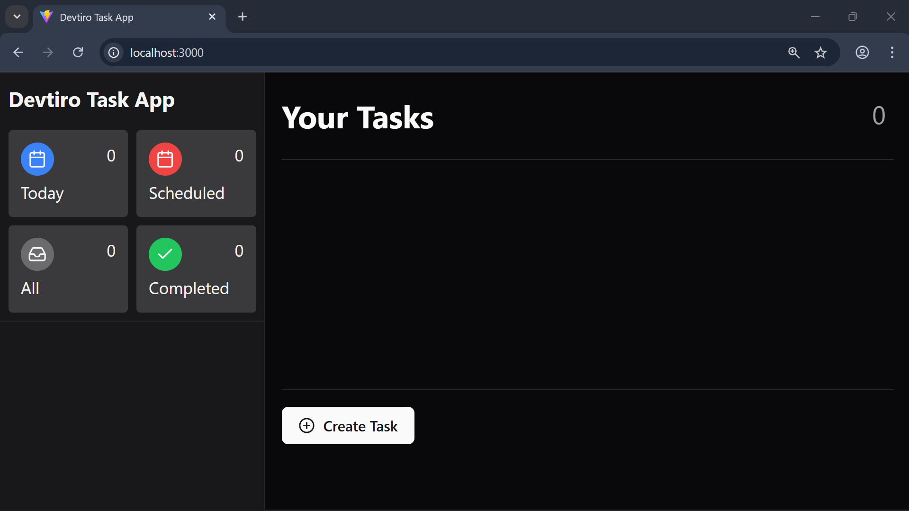

1. Haz clic en el botón «Create Task» de la esquina inferior izquierda de la
   página. Se abrirá un diálogo con un formulario para crear una tarea.


2. Escribe un título, una descripción opcional, una fecha de vencimiento
   opcional y selecciona una prioridad. Haz clic en «Create Task» para crear la
   tarea.

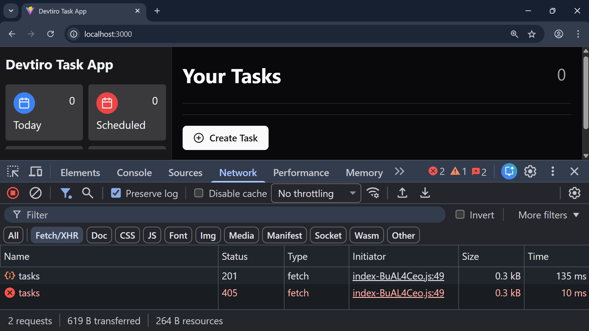

3. Verás que la llamada de crear tarea devuelve `HTTP 201 CREATED`.

Pero espera, ¿por qué no vemos la tarea que hemos creado en la UI? Porque
todavía no hemos implementado el endpoint de listar tareas.

Programémoslo a continuación.

#### Resumen

- Creamos una tarea desde la UI.

## Funcionalidad de listar tareas

### Capa de servicio

Ahora implementaremos el listado de tareas. La buena noticia es que no hay clases
nuevas que crear.

Sin embargo, sí tenemos que actualizar la interfaz `TaskService`.

#### Actualizar la interfaz TaskService

La interfaz `TaskService` ya tiene el método `createTask` que añadimos antes.

Ahora vamos a añadir un segundo método para definir el listado de tareas.

Añadamos el método `listTasks` a la interfaz `TaskService`:

```java
  /**
   * Lists all tasks.
   *
   * @return A list of all tasks.
   */
  List<Task> listTasks();
```

Este método nuevo no necesita argumentos. Simplemente devuelve una lista con
todas las entidades de tarea de la base de datos.

> [!NOTE]
> Devolver todas las entidades de la base de datos no siempre es lo ideal. Si hay
> muchas entidades, podríamos tener serios problemas de rendimiento. La
> _paginación_ es una solución a este reto, pero aquí usamos una lista para que
> el build resulte accesible.

Ahora implementemos el método nuevo.

#### Implementar el método listTasks

Vayamos a `TaskServiceImpl` e implementemos el nuevo método `listTasks`:

```java
  @Override
  public List<Task> listTasks() {
    return taskRepository.findAll(Sort.by(Direction.ASC, "created"));
  }
```

¡En este método delegamos gran parte del trabajo pesado en el repository de
tareas!

Aunque podríamos llamar a `findAll` sin argumentos para obtener una lista de
tareas, le pedimos que ordene los resultados de más antigua a más reciente.

Con esto terminamos la capa de servicio; pasemos al endpoint de listar tareas en
la capa de presentación.

#### Resumen

1. Añadimos el método `listTasks` a la interfaz `TaskService`.
2. Implementamos el método `listTasks`.

### Endpoint de listar tareas

¡Añadamos un endpoint de listar tareas a nuestra REST API!

#### Implementar el endpoint de listar tareas

El endpoint de listar tareas es más sencillo que el de crear tareas:

```java
  /**
   * Lists all tasks with an HTTP 200 OK.
   *
   * @return The list of tasks.
   */
  @GetMapping
  public ResponseEntity<List<TaskDto>> listTasks() {

    // Call the listTasks method on the TaskService to get a list of tasks.
    List<Task> tasks = taskService.listTasks();

    // Map the list of Task objects to a list of TaskDto objects.
    List<TaskDto> taskDtoList = tasks.stream()
        .map(taskMapper::toDto)
        .toList();

    // Return the list of TaskDto objects with an HTTP 200 OK.
    return ResponseEntity.ok(taskDtoList);

  }
```

Usamos `@GetMapping` porque este endpoint usa HTTP `GET`, y al usar HTTP `GET` no
esperamos un cuerpo de petición.

¡Ahí lo tenemos! El endpoint de listar tareas ya está listo para probarlo en la
UI.

#### Resumen

- Implementamos el método `listTasks` en el `TaskController`.

### Pruebas en la UI

Ahora que hemos programado el endpoint de listar tareas, probemos a crear una
tarea otra vez.

Entremos en `http://localhost:3000` desde el navegador.

#### Listar tareas


1. Haz clic en el botón «Create Task» de la esquina inferior izquierda de la
   página. Se abrirá un diálogo con un formulario para crear una tarea.


2. Escribe un título, una descripción opcional, una fecha de vencimiento
   opcional y selecciona una prioridad. Haz clic en «Create Task» para crear la
   tarea.

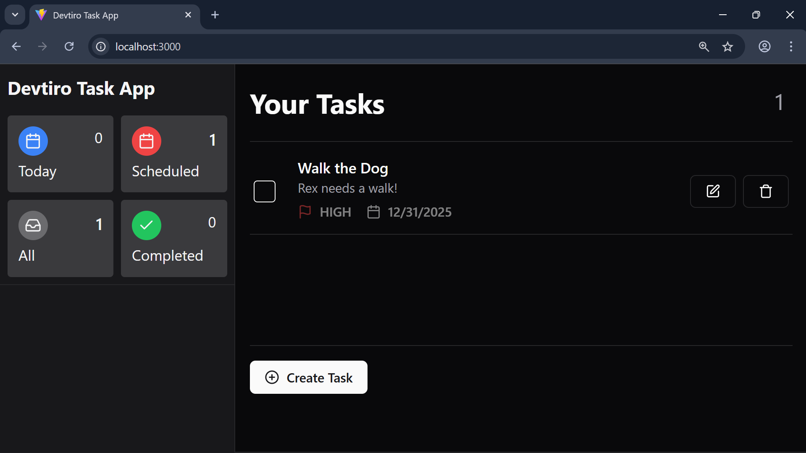

3. Verás la tarea nueva en la lista de tareas.

¡Parece que nuestros endpoints de crear y listar tareas funcionan bien!

Pasemos a programar la funcionalidad de actualizar tareas.

#### Resumen

- Listamos tareas desde la UI.

## Funcionalidad de actualizar tareas

### Objetos de la capa de servicio

El método de crear tarea usa un objeto para recoger toda la información
necesaria para crear una tarea.

Hagamos lo mismo para la funcionalidad de actualizar tarea. Creemos la clase de
petición de actualización.

#### Crear la clase UpdateTaskRequest

Creemos `UpdateTaskRequest` en `com.devtiro.task.domain`:

```java
/**
 * Models a request to update an existing task.
 * This class is owned by the service layer.
 *
 * @param title The title of the task.
 * @param description The description of the task.
 * @param dueDate The date the task is due.
 * @param status The status of the task. Can be null.
 * @param priority The priority of the task.
 */
public record UpdateTaskRequest(
    String title,
    String description,
    LocalDate dueDate,
    TaskStatus status,
    TaskPriority priority) {}
```

Esta clase se diferencia de `CreateTaskRequest` en un aspecto importante: tiene
un campo `status`. Así puede el usuario actualizar el estado de su tarea.

Con la clase creada, ya casi podemos empezar la lógica de negocio, pero primero
tenemos que crear una excepción personalizada.

#### Resumen

- Creamos la clase `UpdateTaskRequest`.

### La excepción TaskNotFoundException

¿Qué deberíamos hacer cuando un usuario intenta actualizar una tarea que no
existe?

Sin duda es un caso de error, así que creemos una excepción personalizada que lo
modele.

#### Crear la excepción TaskNotFoundException

Para mantener el orden, crearemos un package dedicado a nuestras excepciones,
`com.devtiro.task.exception`.

En este package nuevo crearemos `TaskNotFoundException`:

```java
/** Thrown when a task is not found. */
public class TaskNotFoundException extends RuntimeException {

  /** The error message template. */
  public static final String ERROR_MESSAGE =
    "Task with ID '%s' does not exist";

  /** The ID of the task that was not found. */
  private final UUID id;

  /**
   * Constructs a new TaskNotFoundException using
   * the ID of the task not found.
   *
   * @param id The ID of the task not found.
   */
  public TaskNotFoundException(UUID id) {
    super(String.format(ERROR_MESSAGE, id));
    this.id = id;
  }

  public UUID getId() {
    return id;
  }

}
```

Esta excepción tiene un único constructor que espera el ID de la tarea que no se
encontró. Usa ese ID para crear un mensaje de error personalizado que pasa al
constructor de la superclase.

Así capturamos el ID y obtenemos un mensaje de error útil en la traza de la pila.

Ahora podemos pasar a la lógica de negocio.

#### Resumen

- Creamos la clase `TaskNotFoundException`.

### Capa de servicio

Implementemos la lógica de negocio para actualizar una tarea.

#### Actualizar TaskService

Empezaremos actualizando la interfaz `TaskService`.

Definiremos un método nuevo para actualizar una tarea, usando el objeto
`UpdateTaskRequest` que acabamos de crear:

```java
  /**
   * Updates the specified task.
   *
   * @param taskId The ID of the task to update.
   * @param request The request object used to update the task.
   * @return The updated task.
   */
  Task updateTask(UUID taskId, UpdateTaskRequest request);
```

Hemos indicado dos argumentos en el método `updateTask`: el objeto
`UpdateTaskRequest` y el ID de la tarea a actualizar.

Indicamos el ID de la tarea como argumento propio porque se pasa en la ruta de la
URL, no en el cuerpo de la petición.

¡Implementemos el método nuevo!

#### Implementar el método updateTask

En la clase `TaskServiceImpl`, implementemos el método nuevo:

```java
  @Override
  public Task updateTask(UUID taskId, UpdateTaskRequest request) {

    // Look up the existing task. If it doesn't exist
    // throw a TaskNotFoundException
    Task existingTask = taskRepository.findById(taskId).orElseThrow(() ->
        new TaskNotFoundException(taskId)
    );

    // Update the existing task with the provided information.
    existingTask.setTitle(request.title());
    existingTask.setDescription(request.description());
    existingTask.setDueDate(request.dueDate());
    existingTask.setPriority(request.priority());
    existingTask.setStatus(request.status());

    // Update the existing task's updated value.
    existingTask.setUpdated(Instant.now());

    // Save the existing task.
    return taskRepository.save(existingTask);

  }
```

El método busca la tarea existente en la base de datos, la actualiza con los
valores recibidos y guarda los cambios. Si la tarea no existe, se lanza
`TaskNotFoundException`.

Con esto terminamos la capa de servicio. Creemos los DTO y los métodos del mapper
que usaremos en la capa de presentación.

#### Resumen

- Actualizamos la interfaz `TaskService`.
- Implementamos el método `updateTask`.

### Mapper de DTO

Creemos el DTO y el método del mapper que necesitaremos para el endpoint de
actualizar tarea.

#### Crear el DTO UpdateTaskRequestDto

Ya hemos creado la clase `UpdateTaskRequest` en la capa de servicio. Creemos su
DTO equivalente para la capa de presentación.

Creamos la clase `UpdateTaskRequestDto` en `com.devtiro.task.domain.dto`:

```java
/**
 * A DTO modelling a request to update an existing task.
 * This class is owned by the presentation layer.
 *
 * @param title The title of the task to update.
 * @param description The description of the task to update.
 * @param dueDate The date the task is due.
 * @param status The status of the task to update.
 * @param priority The priority of the task to update.
 */
public record UpdateTaskRequestDto(
    @NotBlank(message = ERROR_MESSAGE_TITLE_LENGTH)
    @Length(max = 255, message = ERROR_MESSAGE_TITLE_LENGTH)
    String title,

    @Length(max = 1000, message = ERROR_MESSAGE_DESCRIPTION_LENGTH)
    @Nullable
    String description,

    @FutureOrPresent(message = ERROR_MESSAGE_DUE_DATE_FUTURE)
    @Nullable
    LocalDate dueDate,

    @NotNull(message = ERROR_MESSAGE_STATUS)
    TaskStatus status,

    @NotNull(message = ERROR_MESSAGE_PRIORITY)
    TaskPriority priority) {

  private static final String ERROR_MESSAGE_TITLE_LENGTH =
      "Title must be between 1 and 255 characters";
  private static final String ERROR_MESSAGE_DESCRIPTION_LENGTH =
      "Description must be less than 1000 characters";
  private static final String ERROR_MESSAGE_DUE_DATE_FUTURE =
      "Due date must be in the future";
  private static final String ERROR_MESSAGE_STATUS =
      "Status must be provided";
  private static final String ERROR_MESSAGE_PRIORITY =
      "Task priority must be provided";

}
```

La clase `UpdateTaskRequestDto` tiene los mismos campos que `UpdateTaskRequest`.
Sin embargo, el DTO lleva anotaciones de validación y la clase de la capa de
servicio no.

Ahora, el método del mapper.

#### Actualizar la interfaz TaskMapper

Solo tenemos que añadir un método a la interfaz `TaskMapper`:

```java
  UpdateTaskRequest fromDto(UpdateTaskRequestDto dto);
```

Este método se encarga de convertir el DTO que acabamos de crear,
`UpdateTaskRequestDto`, en un `UpdateTaskRequest` que podamos pasar a la capa de
servicio.

¡Implementemos el método nuevo!

#### Implementar la interfaz TaskMapper

En `TaskMapperImpl` tenemos el método nuevo por implementar:

```java
  @Override
  public UpdateTaskRequest fromDto(UpdateTaskRequestDto dto) {
    return new UpdateTaskRequest(
        dto.title(),
        dto.description(),
        dto.dueDate(),
        dto.status(),
        dto.priority()
    );
  }
```

Con esto ya tenemos todo lo necesario para implementar el endpoint de actualizar
tarea.

#### Resumen

- Creamos la clase `UpdateTaskRequestDto`.
- Actualizamos la interfaz `TaskMapper`.
- Implementamos el nuevo método de `TaskMapper`.

### Endpoint de actualizar tarea

Ahora el penúltimo endpoint de la REST API. ¡Implementemos el endpoint de
actualizar tarea!

#### Implementar el endpoint de actualizar tarea

Añadamos el siguiente método a la clase `TaskController`:

```java
  /**
   * Updates the specified task with the provided information.
   *
   * @param taskId The ID of the task to update.
   * @param updateTaskRequestDto The request DTO used to update the task.
   * @return A representation of the updated task with an HTTP 200.
   */
  @PutMapping(path = "/{taskId}")
  public ResponseEntity<TaskDto> updateTask(
      @PathVariable UUID taskId,
      @Valid @RequestBody UpdateTaskRequestDto updateTaskRequestDto) {

    // Map the UpdateTaskRequestDto to an UpdateTaskRequest.
    UpdateTaskRequest updateTaskRequest = taskMapper.fromDto(
        updateTaskRequestDto
    );

    // Pass the UpdateTaskRequest to the TaskService's updateTask method.
    Task updatedTask = taskService.updateTask(taskId, updateTaskRequest);

    // Map the Task to a TaskDto.
    TaskDto taskMapperDto = taskMapper.toDto(updatedTask);

    // Return the TaskDto with an HTTP 200.
    return ResponseEntity.ok(taskMapperDto);

  }
```

La anotación `@PutMapping` indica que se usa el método HTTP `PUT`, y su argumento
nos permite extraer el ID de la tarea de la ruta de la URL.

La cadena del argumento especifica la variable `{taskId}`. Debe coincidir con el
nombre del argumento anotado con `@PathVariable`. El framework se encarga de
extraer el valor de la ruta de la URL.

Habrás notado que seguimos un patrón parecido al del endpoint de crear tarea.

Pero todavía no estamos listos para probar el endpoint de actualización. ¡Primero
tenemos que gestionar `TaskNotFoundException`!

#### Resumen

- Implementamos el método `updateTask` en `TaskController`.

### Gestión de excepciones

Hace poco introdujimos `TaskNotFoundException`. Ahora vamos a gestionarla en el
gestor global de excepciones.

#### Actualizar el GlobalExceptionHandler

Cuando una `TaskNotFoundException` llega a la capa de presentación, queremos
devolver un mensaje de error estándar y útil, junto con el código de estado
`HTTP 400 BAD REQUEST`.

Añadamos este handler a la clase `GlobalExceptionHandler`:

```java
  /**
   * Handles the TaskNotFoundException, returning a standardised error
   * response and an HTTP 400.
   * This exception is thrown when the specified task is not found.
   *
   * @param ex The TaskNotFoundException.
   * @return The standardised error and an HTTP 400.
   */
  @ExceptionHandler({TaskNotFoundException.class})
  public ResponseEntity<ErrorResponseDto> handleExceptions(
    TaskNotFoundException ex) {

    // Create an ErrorResponseDto using a templated error message.
    ErrorResponseDto errorResponseDto = new ErrorResponseDto(
        String.format("Task with ID '%s' not found", ex.getId())
    );

    // Return the ErrorResponseDto with status HTTP 400 BAD REQUEST.
    return new ResponseEntity<>(errorResponseDto, HttpStatus.BAD_REQUEST);
  }
```

Con `TaskNotFoundException` gestionada, ¡probemos la funcionalidad de actualizar
tarea en la UI!

#### Resumen

- Añadimos la gestión de la clase `TaskNotFoundException`.

### Pruebas en la UI

Ahora que hemos programado el endpoint de actualizar tarea, probemos esta
funcionalidad en la UI.

Entremos en `http://localhost:3000` desde el navegador.

#### Actualizar una tarea

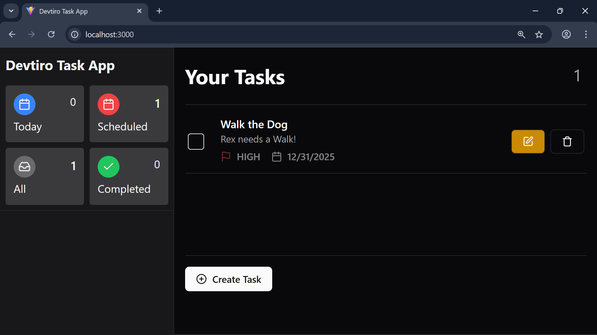

1. Haz clic en el botón de editar de la tarea que quieras modificar. Se abrirá
   un diálogo para editar la tarea existente.

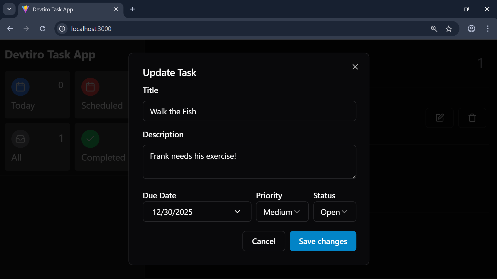

2. Verás todos los datos actuales de la tarea. Edita cada campo. Haz clic en
   «Save Changes».


3. Verás la tarea actualizada en la lista de tareas.

#### Resumen

- Actualizamos una tarea desde la UI.

## Funcionalidad de eliminar tareas

### Capa de servicio

Programemos la lógica de negocio de eliminar tarea en la capa de servicio.

#### Actualizar TaskService

En `TaskService` añadiremos la última definición de método:

```java
  /**
   * Deletes the specified task.
   * Does not throw an exception when the specified task does not exist.
   *
   * @param taskId The ID of the task to delete.
   */
  void deleteTask(UUID taskId);
```

Este método recibe el ID de la tarea a eliminar y no devuelve nada.

Quizá te preguntes qué hacer cuando el usuario intenta eliminar una tarea que no
existe. En este caso, **no lanzaremos una excepción**.

Piénsalo así: tanto si la tarea existía como si no, después de llamar a este
método está claro que ya no existe.

Puede resultar un poco contraintuitivo, pero es la forma en que muchas REST APIs
implementan el borrado, así que seguiremos el mismo criterio en nuestra capa de
servicio.

Ahora, implementemos el método de eliminar tarea.

#### Implementar el método deleteTask

En `TaskServiceImpl`, implementemos el método nuevo:

```java
  @Transactional
  @Override
  public void deleteTask(UUID taskId) {
    taskRepository.deleteById(taskId);
  }
```

¡La implementación es una sola línea! Delegamos toda la responsabilidad de
eliminar la tarea en el repository. A esto a veces lo llamamos implementación
«pass through» (de paso). ¡Otro ejemplo de toda la funcionalidad que ofrecen los
repositories de serie!

Con esto terminamos la capa de servicio; pasemos a la capa de presentación.

#### Resumen

- Añadimos el método `deleteTask` a la interfaz `TaskService`.
- Implementamos el método `deleteTask`.

### Endpoint de eliminar tarea

¡Implementemos el último endpoint de la REST API, el de eliminar tarea!

#### Implementar el endpoint de eliminar tarea

La clase `TaskController` está casi completa; solo queda un endpoint por añadir:

```java
  /**
   * Deletes the specified Task.
   * Always returns an HTTP 204 NO CONTENT.
   *
   * @param taskId The ID of the task.
   * @return An HTTP 204 NO CONTENT.
   */
  @DeleteMapping(path = "/{taskId}")
  public ResponseEntity<Void> deleteTask(@PathVariable UUID taskId) {

    // Call the deleteTask method on the TaskService.
    taskService.deleteTask(taskId);

    // Return an HTTP 204 NO CONTENT.
    return new ResponseEntity<>(HttpStatus.NO_CONTENT);

  }
```

Fíjate en el `Void` de `ResponseEntity`. Se usa cuando no hay cuerpo de respuesta,
que es exactamente lo que esperamos para `HTTP 204 NO CONTENT`.

Este endpoint espera el ID de la tarea en la ruta de la URL. El framework lo
extrae y lo pasa al método `deleteTask`.

¡Probemos el endpoint de eliminar tarea en la UI!

#### Resumen

- Implementamos el método `deleteTask` en la clase `TaskController`.

### Pruebas en la UI

Ahora que hemos programado el endpoint de eliminar tarea, probemos esta última
funcionalidad en la UI.

Entremos en `http://localhost:3000` desde el navegador.

#### Eliminar una tarea

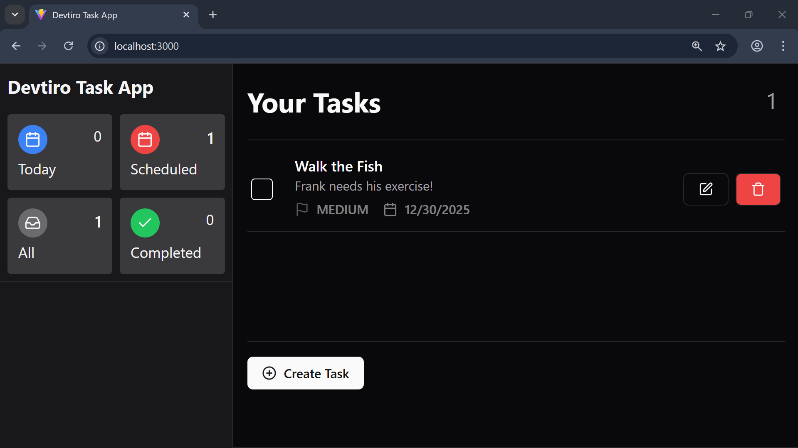

1. Haz clic en el botón de eliminar que hay junto a la tarea que quieras borrar.
   Se abrirá el diálogo de eliminación de la tarea.


2. Haz clic en «Delete» para eliminar la tarea.

¡Ahí lo tenemos! La funcionalidad de eliminar tarea funciona como esperábamos.

#### Resumen

- Eliminamos una tarea desde la UI.

## Qué viene ahora

### Próximos pasos

Si has llegado hasta aquí, ¡enhorabuena!

Construir una app de principio a fin no es fácil; es un logro enorme. ¡Bien
hecho!

Ahora, ¿hacia dónde sigues?

#### Sube tu código a GitHub

¿Por qué no subes tu app terminada a GitHub? ¡Es una forma estupenda de mostrar
tu logro al mundo!

> [!CAUTION]
> Sube solo tu código. No está permitido subir este libro.

Solo te pido que menciones a Devtiro en tu archivo `README`. Eso me permite
llegar y ayudar a más gente.

Quizá algo pequeño como:

```markdown
[Built with Devtiro](https://www.youtube.com/@devtiro).
```

¡Te lo agradezco!

---

*Traducción no oficial al español de [Task App V2](./task-app-v2-combined.md), de
Devtiro Ltd. El original y esta adaptación están publicados bajo
[CC BY-NC-SA 4.0](./LICENSE).*
